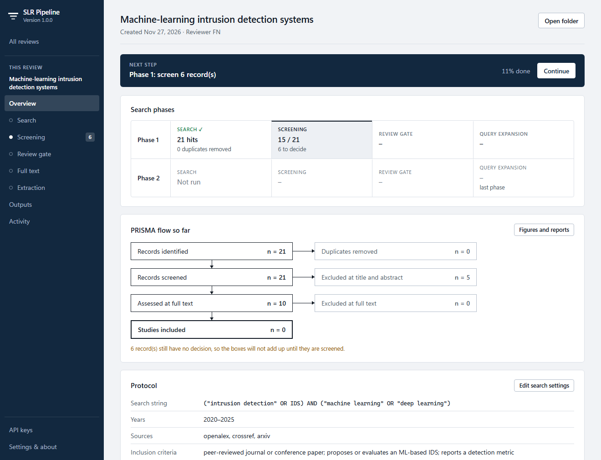
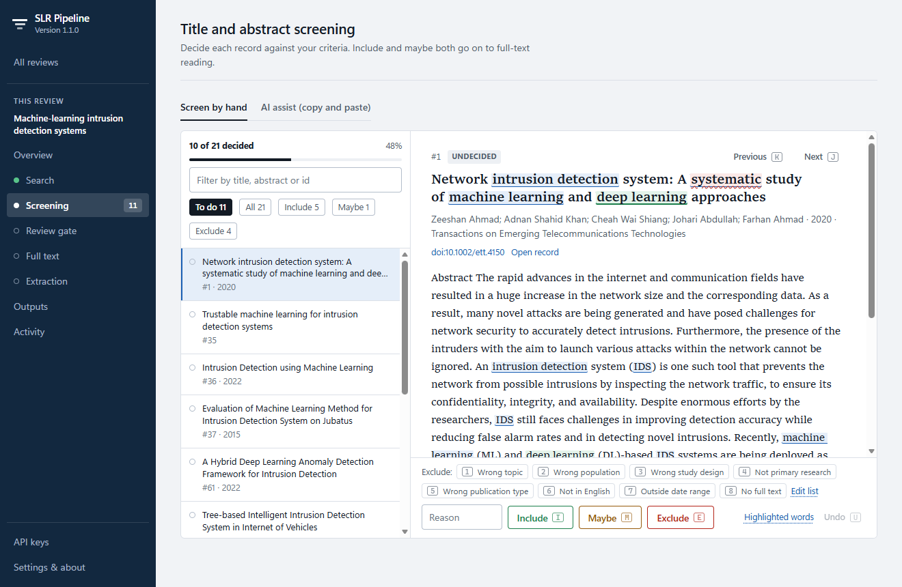
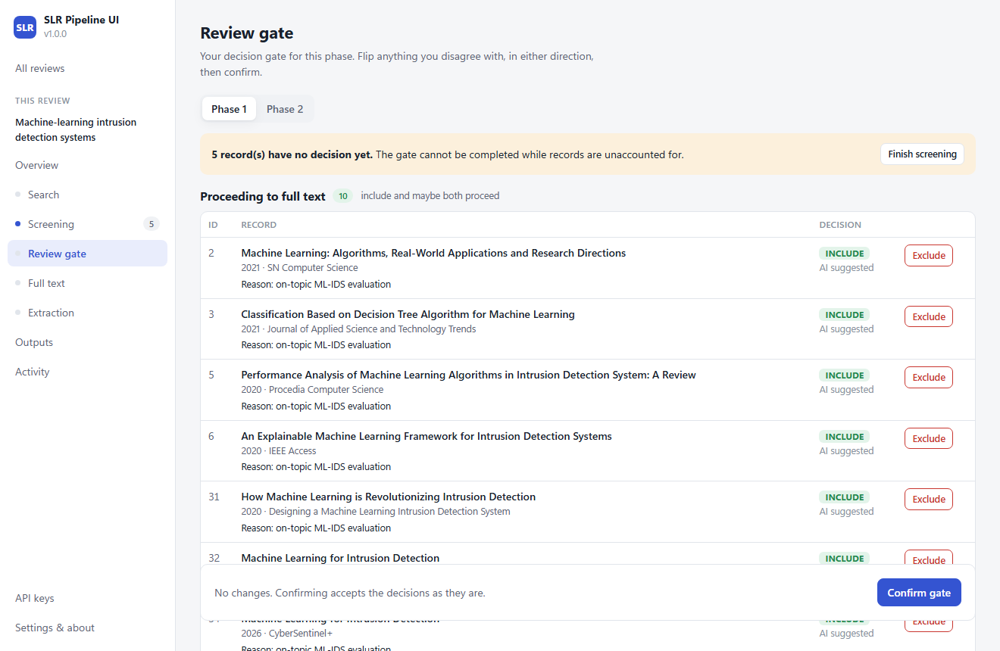
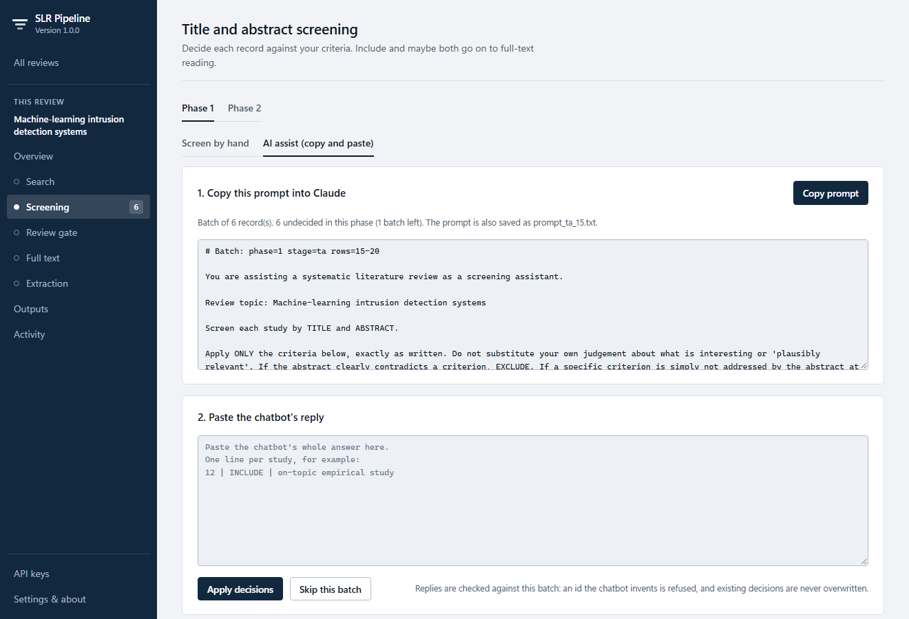
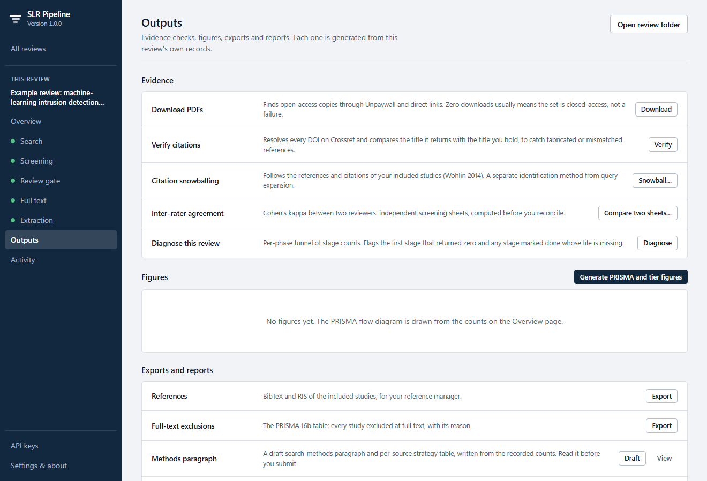

# SLR Pipeline UI

A desktop app for running a systematic literature review (SLR) end to end:
protocol, multi-source search, deduplication, title/abstract screening,
full-text assessment, data extraction, quality appraisal, PRISMA 2020 figures
and an audit trail, in one window.

It is a redesigned and enhanced UI for the original SLR Pipeline project, built
on top of [slr-pipeline](https://github.com/nayeem-hossain/slr-pipeline) by
Md Nayeem Hossain. The review method, the stage scripts and the guided terminal
app are his work and ship here with only the small changes listed in the
changelog; this project adds the desktop app around them. A review folder made in one interface opens in the
other.



## What the desktop app adds

- **One window for the whole review.** A list of your reviews with progress, an
  overview that always shows the next step, and one page per stage: search,
  screening, review gate, full text, extraction, outputs.
- **Screening built for reading.** One record at a time with its abstract and
  your eligibility criteria beside it, a filterable list, a progress bar, and
  single-key decisions (`I` include, `M` maybe, `E` exclude, `J`/`K` to move).
  Every decision you make by hand is written to the audit trail with your
  initials, the same way an AI-assisted one is.
- **AI assist without files.** Copy the prompt with one button, paste the
  chatbot's reply into a box, and apply it. The reply is still checked against
  the batch that was sent, and the prompt and reply are still saved next to the
  review.
- **A review gate you can see.** Proposed includes and excludes side by side,
  with the fixed sample of AI exclusions the method asks you to check; flip a
  record in either direction with one click and confirm.
- **A live PRISMA flow.** Counts are derived from the review's own files every
  time you look, with a warning when they do not balance yet.
- **Work that is not silently lost.** Re-running a search starts a blank
  screening sheet and keeps the old one as a backup; rebuilding the merged set
  keeps full-text decisions; rebuilding the extraction sheet keeps what you
  typed.
- **Long stages stay visible.** Search, PDF download, citation verification and
  figures run in the background with a live log and a cancel button.
- **Light and dark themes**, keyboard navigation, and a browser mode for
  machines without a native web view.

| Screening | Review gate |
|---|---|
|  |  |
| **AI assist** | **Outputs** |
|  |  |

## What the pipeline underneath does (unchanged from slr-pipeline)

- **Citation verification is a pipeline stage.** Every reference's DOI is
  resolved against Crossref and its title matched against the record Crossref
  holds, so fabricated or mis-attributed references are caught by the tool
  rather than by a reader of the finished review.
- **The audit trail is a file you own.** Searches, deduplication decisions,
  screening decisions and their reasons, and verification outcomes are written
  to an append-only provenance log that belongs to the project. The PRISMA
  counts and the first draft of the methods paragraph are generated from that
  record, not reconstructed from memory.
- **Local-first.** Everything runs on your own machine. The only network
  traffic is to the scholarly APIs it searches and to Crossref. Where AI
  assistance is used, it is a manual-paste step into a chatbot you choose, and
  every suggestion passes a human review gate before it becomes a decision, so
  the assistance can be disclosed accurately.

The worked example used throughout the documentation is **machine-learning /
AI-based intrusion detection systems (ML-IDS)**. Swap the search terms and the
inclusion/exclusion criteria for your own topic; the method does not change.

## Documentation

- [The desktop app](docs/desktop-app.md) - each screen, the keyboard shortcuts,
  where your data lives, and how the app is put together.
- [The 7-stage method](docs/methodology.md) - the methodology the pipeline
  implements, stage by stage, with the integrity and end-to-end checklists.
- [Script reference](docs/script-reference.md) - every stage script and the
  `src/srp/` library, command by command.
- [AI-assist screening](docs/ai-assist.md) - where AI fits in the pipeline,
  the prompt packs it uses, and the guardrails around it.

## Installing

You need Python 3.10 or newer ([python.org](https://www.python.org/downloads/);
on Windows tick "Add python.exe to PATH" in the installer). Then, in a terminal:

```bash
pip install slr-pipeline-ui
slr-ui
```

That is the whole installation. You do not need this GitHub repository, git, or
any other download. The first time the app opens it offers to **add a desktop
shortcut**; after that you start it with a double-click and never need the
terminal again (`slr-ui --shortcut` does the same from the command line).

Not sure yet? On the first screen choose **Try the example review**: 21 bundled
records, no account, no API key, nothing sent anywhere.

`pipx install slr-pipeline-ui` works the same way and keeps the app in its own
environment. To run the latest code from GitHub instead:
`pip install git+https://github.com/faizunnur/SLR_Pipeline_UI.git`.

Three commands are installed:

| Command | What it starts |
|---|---|
| `slr-ui` | The desktop app, from a terminal. Use this one for `--help`. |
| `slr-desktop` | The same app with no console window, for a shortcut or the Start menu. |
| `slr` | The original guided terminal app, unchanged. |

The window uses the web view your system already has: Edge WebView2 on Windows
10/11, WebKit on macOS. On Linux install GTK or Qt bindings for
[pywebview](https://pywebview.flowrl.com/guide/installation.html), or skip the
window and run `slr-ui --browser`, which shows the same app in your default
browser. Browser mode listens on `127.0.0.1` only and needs the one-time token
in the address it opens.

Do not install this next to the original `slr-pipeline` in the same
environment: both provide the `slr` command and the `srp` package. This
distribution already contains the pipeline.

From a source checkout, without installing:

```bash
git clone https://github.com/faizunnur/SLR_Pipeline_UI.git
cd SLR_Pipeline_UI
pip install -r requirements.txt
python -m slr_desktop        # run from the src/ folder, or with PYTHONPATH=src
```

For a review you intend to publish, install the pinned versions in
`requirements.lock` (plus `pywebview`) and cite them in your methods section.

## First review in five steps

1. **New review**: three short pages. Only the topic and a contact email are
   required; add one row of synonyms per idea in your question and your
   inclusion and exclusion criteria. The search string is shown as you type.
   A fourth page of reporting details is optional and can be skipped.
2. **Search**: press *Run search*. The log at the bottom shows each source;
   the per-source record (retrieved, available, truncated) is kept for your
   methods section.
3. **Screening**: decide each record by hand, or use *AI assist* to paste
   batches through a chatbot, then check them.
4. **Review gate**: flip anything you disagree with, confirm. With more than
   one phase, pick the expansion terms for the next search.
5. **Full text**, **Extraction**, **Outputs**: record full-text decisions with
   reasons, code the included studies, then generate the PRISMA diagram,
   references, the methods paragraph and the provenance report.

Your reviews live in a workspace folder (by default `Documents/SLR Pipeline`):
one folder per review under `runs/`, and your API keys in `.env`. Keys are
never written into a review folder, so a review folder is safe to share.

**Keeping up to date.** *Settings & about* has a *Check for updates* button. The
app never updates itself: changing versions in the middle of a review can change
deduplication or counting part-way through its corpus. Update when you choose
to, with `pip install -U slr-pipeline-ui`. The version used (and the
slr-pipeline release it is built on) is recorded in every review's provenance.

## The terminal app and the stage scripts

The desktop app is one of three ways to run the same pipeline. The other two
come from slr-pipeline and work exactly as they do there.

**a) Guided terminal app: `python src/slr.py`** (or just `slr` if pip/pipx-installed)

An interactive terminal (needs `questionary` + `rich`, see [Running the
pipeline](#running-the-pipeline) below) that walks you through a setup wizard
-- topic, keywords, eligibility criteria, year range, contact email, optional
API keys, which sources to search, how many search phases, which web chatbot
you'll paste screening prompts into, your reviewer name -- then runs each phase
for you: search -> dedup -> prescreen skeleton -> manual-paste AI-assist
screening -> human review gate -> query expansion into the next phase.
Once every phase is done it opens a consolidation menu: merge TA-included
studies across phases, run **citation snowballing** (backward + forward,
Wohlin 2014) and merge its results in, download PDFs, **full-text screening**,
verify citations, build the extraction sheet, generate figures, export
references, export full-text exclusions with reasons, compute **inter-rater
agreement**, draft the search-methods paragraph, write a review
self-appraisal checklist, and write the provenance report.

> **Terminology:** the between-phase step is **query expansion** -- it suggests
> extra keywords drawn from the terms frequent in your included titles. It is not
> citation snowballing (Wohlin 2014), which walks the reference/citation graph.
> The two are not interchangeable: snowballing exists to escape your search
> string's keyword bias, whereas expanding the query with words you already found
> narrows toward that same vocabulary. If your protocol promises snowballing, use
> the consolidation menu's **Citation snowballing** action (or `src/scripts/snowball.py`
> directly in the manual path) and record it as a separate identification method.

It is **resumable**: re-run `python src/slr.py`, choose "Resume an existing
review," and it fast-forwards past every already-completed stage using saved
checkpoints. Every review lives under its own `runs/<run-id>/` workspace
(gitignored -- see [The srp/ library](#the-srp-library-config-state-provenance-export)
below).

A pipeline CSV that exists but can't actually be parsed (truncated mid-write,
saved with the wrong encoding) is never treated as if it were simply missing
or empty -- it stops the wizard with a clear message naming the file, instead
of silently reporting "0 records" for a stage that actually failed to read
its input. Fix or remove the named file, then resume the run.

```bash
python src/slr.py
```

**b) Manual (advanced / transparent): run the stage scripts yourself**

Every stage `slr.py` runs under the hood is also a standalone script under
`src/scripts/`, invocable directly. This is the same pipeline with nothing
hidden -- useful if you want to inspect or hand-edit intermediate CSVs
between stages, run a single stage in isolation, or wire the pipeline into
your own automation. See [Running the pipeline](#running-the-pipeline) for
the full command sequence.

```bash
git clone <this-repo-url>
cd slr-pipeline

python -m venv .venv
source .venv/bin/activate            # Windows: .venv\Scripts\activate
pip install -r requirements.lock     # exact pins; requirements.txt = minimums

cp .env.example .env                 # fill in a real MAILTO; add any API keys here
                                     # (loaded automatically; flags override it)

python src/scripts/search.py \
    --query '"intrusion detection" AND "machine learning"' \
    --year-from 2020 --year-to 2026 \
    --mailto you@example.com \
    --max-per-source 40 \
    --out output/candidates.csv

python src/scripts/dedup.py  --in output/candidates.csv       --out output/candidates_dedup.csv
python src/scripts/screen.py --in output/candidates_dedup.csv --out output/screening.csv

# Manual-paste AI-assist screening (no API keys) -- see "AI-assist screening" below
python src/scripts/assist.py build --in output/candidates_dedup.csv --stage ta \
    --out prompt_ta.txt --topic "ML-IDS systematic review"
# paste prompt_ta.txt into any free web chatbot; save the reply to reply.txt
python src/scripts/assist.py parse --response reply.txt --into output/screening.csv --stage ta

python src/scripts/download.py --in output/candidates_dedup.csv --mailto you@example.com --outdir pdfs
python src/scripts/verify_citations.py --csv output/candidates_dedup.csv --limit 10

# Once a human has filled in ta_decision/ft_decision in screening.csv:
python src/scripts/extract.py --in output/screening.csv --out output/extraction.csv

# Once a human has filled in venue_tier/R/A/T/C/quality_tier in extraction.csv:
python src/scripts/figures.py --quality output/extraction.csv --outdir figures

# Export the included set for your reference manager:
python src/scripts/export.py --in output/extraction.csv --out-bib references.bib \
    --out-ris references.ris --included-only
```

### Tests

```bash
pip install pytest
python -m pytest tests/
```

The suite covers the functions whose silent breakage would put a wrong number in
a published paper: deduplication in both directions (false merges *and* missed
preprint/published pairs), the PRISMA count derivation and its cross-phase
totals, the chatbot-reply parser's refusal to fabricate or misattribute a
decision, BibTeX key collisions, Cohen's kappa against its textbook worked
example, and the guarantee that API keys never reach `runs/<id>/config.json`.
Run it after changing anything under `src/srp/` or `src/scripts/`.

A real run of either path writes `output/` and `pdfs/` (manual path) or
`runs/<run-id>/` (guided path) into your working directory -- both are
gitignored. This repository ships with a **committed demonstration run**
instead, under `examples/`: `examples/demo_output/` holds the real CSVs
produced by an actual ML-IDS search (candidates, dedup, screening, download
log, citation verification). The open-access PDFs that `src/scripts/download.py`
fetched for that same run are not tracked in git (12 PDFs, ~50 MB of
example data that every `pipx`/`pip install git+...` would otherwise
re-download for no reason) and are not distributed with the releases;
the CSVs in `examples/demo_output/` are the demonstration record. `examples/` additionally keeps a small curated
sample of each output -- including a fully-decided screening sheet, a
filled-in extraction/quality-scoring sheet, and the figures `src/scripts/figures.py`
renders from them (`examples/figures/`) -- so you can see the CSV and figure
shapes at a glance; see `examples/README.md` for the exact commands used and
one real API gotcha hit along the way.

### What you change vs. what you don't

Every script under `src/scripts/` follows the same convention, stated right after
its module docstring: the **command-line flags are what you're meant to
change** day to day (search terms, thresholds, paths, `--mailto`) -- run
`python src/scripts/<script>.py --help` to see them. The code *below* that point
is marked in two ways: `# --- API internals ---` over anything that builds a
request URL or parses a response from an external API (breaks only if that
API's contract changes), and `# --- core logic ---` over the dedup match
loop, the PRISMA count derivation, and the plotting geometry (safe to leave
alone unless you're deliberately extending the tool). You should not need to
edit anything below either marker for a normal review. `slr.py` and the
`src/srp/` library follow the same two markers for the same reason -- the wizard
prompts and consolidation menu are what you interact with; the phase
orchestration and query-expansion logic underneath are marked `# --- core logic ---`
and don't need touching for a normal review either.

## Repository layout

```
SLR_Pipeline_UI/
├── src/
│   ├── slr_desktop/            # the desktop app (new in this project)
│   │   ├── app.py              # starts the window (`slr-ui`, `slr-desktop`)
│   │   ├── api.py              # the bridge the page calls
│   │   ├── service.py          # every pipeline operation, with no UI code
│   │   ├── jobs.py             # background tasks with a live log
│   │   ├── server.py           # browser mode (`slr-ui --browser`)
│   │   └── web/                # the front end: HTML, CSS, JavaScript
│   ├── slr.py                  # guided terminal app (`slr`)
│   ├── srp/                    # importable library
│   │   ├── config.py           # ReviewConfig (secrets are never persisted)
│   │   ├── env.py              # .env loader
│   │   ├── normalize.py        # THE definition of "same DOI" / "same title"
│   │   ├── state.py            # run workspace, atomic checkpoints, decision log
│   │   ├── decisions.py        # the single AI-decision ingestion path
│   │   ├── agreement.py        # Cohen's kappa + conflict lists
│   │   ├── appraisal.py        # field -> critical-appraisal instrument registry
│   │   ├── methods_report.py   # auto-draft the search-methods paragraph
│   │   ├── llm_assist.py       # screening prompt builder + reply parser
│   │   ├── provenance.py       # append-only log + PROVENANCE.md
│   │   └── export.py           # BibTeX / RIS
│   └── scripts/                # the individual stage CLIs (manual / advanced use)
│       ├── search.py           # query up to 10 scholarly APIs
│       ├── dedup.py            # DOI-exact then fuzzy-title+author deduplication
│       ├── screen.py           # build the title/abstract + full-text screening sheet
│       ├── assist.py           # manual-paste AI-assist screening (build prompt / parse reply)
│       ├── snowball.py         # real citation snowballing (backward + forward, OpenAlex)
│       ├── download.py         # resolve + fetch open-access PDFs (arXiv, Unpaywall, OpenAlex, S2, CORE)
│       ├── verify_citations.py # fabricated-citation guard: DOI -> Crossref -> diff
│       ├── extract.py          # build the Stage-4/5 extraction + quality-scoring template
│       ├── figures.py          # PRISMA flow diagrams + quality-/venue-tier charts
│       └── export.py           # export included studies to BibTeX / RIS
├── docs/                       # the full guides: methodology, script reference, AI-assist
├── tests/                      # pytest suite (`python -m pytest tests/`)
├── examples/                   # demo inputs, a completed demo run, and generated figures
│   ├── README.md
│   ├── *_sample.csv            # small curated sample of each stage's output
│   ├── demo_output/            # CSV outputs of the ML-IDS demonstration run
│   └── figures/                # prisma_flow, prisma_2020, quality_tiers, venue_tiers (.png + .pdf)
│   # demo_pdfs/ (the open-access PDFs from that run) is NOT tracked here and is
│   # not distributed with the releases, so a `pipx`/`pip install git+...` never
│   # has to download 50 MB of example PDFs to run the tool.
├── .github/workflows/tests.yml # CI: runs the pytest suite on push/PR
├── pyproject.toml              # package metadata; `slr-ui`, `slr-desktop` and `slr` entry points
├── requirements.txt            # minimum versions
├── requirements.lock           # exact pins -- use these for a review you'll publish
├── .env.example
├── CITATION.cff                # citation metadata for the software
├── LICENSE.txt                 # MIT -- applies to the code (everything under src/)
├── NOTICE                      # what comes from slr-pipeline and what is new here
├── LICENSE-docs                # CC-BY-4.0 -- applies to README.md, docs/, examples/README.md
└── .gitignore                  # ignores output/, pdfs/, runs/ -- a real run's working files
```

## The end-to-end workflow

```
Protocol  ->  Search  ->  Screen  ->  Extract  ->  Quality-assess  ->  Synthesize  ->  Report
 (PICOC,       (multi-    (title/     (per-study    (R/A/T/C           (narrative      (PRISMA
  RQs,          round      abstract    schema,       rubric,            by RQ,          flow +
  criteria,     Boolean    then       verbatim       Low/Some/          consistency     checklist,
  pre-reg)      queries)   full-text)  numbers)      High per dim)      assessment)     data avail.)
```

`src/scripts/search.py` -> `src/scripts/dedup.py` -> `src/scripts/screen.py` cover Search
and the mechanical half of Screening; `src/scripts/assist.py` optionally
manual-paste-AI-assists the screening decisions, but the decision columns
stay a human call either way. `src/scripts/snowball.py` adds a second,
non-keyword identification method -- real backward/forward citation
snowballing (Wohlin 2014) seeded from your included set, as distinct from
the between-phase query-expansion loop. `src/scripts/download.py` retrieves full
text for the full-text screening and extraction stages. `src/scripts/extract.py`
builds the Extract + Quality-assess template (`R`/`A`/`T`/`C` rubric columns,
again left blank for a human), optionally extended with a field-appropriate
instrument's verbatim domains from `src/srp/appraisal.py`. `src/scripts/verify_citations.py`
runs continuously, against every citation you plan to use, from extraction
through final manuscript. `src/scripts/figures.py` covers Report's PRISMA flow
diagram(s) and the quality-/venue-tier distribution charts; `src/srp/methods_report.py`
drafts the search-methods paragraph from the same recorded search-strategy
log. `src/scripts/export.py` covers Report's reference-list handoff to your
citation manager. `slr.py` orchestrates all of the above end to end, plus the
query-expansion loop between search rounds and the always-on provenance log.

---

## Citing

If this software contributes to a published review, please cite it using the
metadata in `CITATION.cff` (GitHub renders it as the "Cite this repository"
button), and cite the original
[slr-pipeline](https://github.com/nayeem-hossain/slr-pipeline) it is built on;
`CITATION.cff` lists it under `references`. Reviews should also report the
version used; the provenance report records it automatically.

## Credits

The review pipeline, its methodology and the guided terminal app are the work
of **Md Nayeem Hossain**: [slr-pipeline](https://github.com/nayeem-hossain/slr-pipeline).
SLR Pipeline UI is built on release 1.3.4 of that project. [`NOTICE`](NOTICE)
lists which files come from it and which are new here.

## License

Licensing is split by content type, as in the original project:

- **Code** (everything under `src/`: the desktop app in `src/slr_desktop/`, and
  `slr.py`, `src/srp/`, `src/scripts/` from slr-pipeline) is licensed under the
  **MIT License** -- see [`LICENSE.txt`](LICENSE.txt).
- **Documentation** (this README, `docs/` and `examples/README.md`) is licensed
  under **Creative Commons Attribution 4.0 International (CC-BY-4.0)** -- see
  [`LICENSE-docs`](LICENSE-docs). It is adapted from slr-pipeline's
  documentation; the changes are stated in that file.

Copyright (c) 2026 Md Faizun Nur Islam (SLR Pipeline UI: the desktop app and the changes
made in this repository).
Copyright (c) 2026 Md Nayeem Hossain (the original slr-pipeline).
